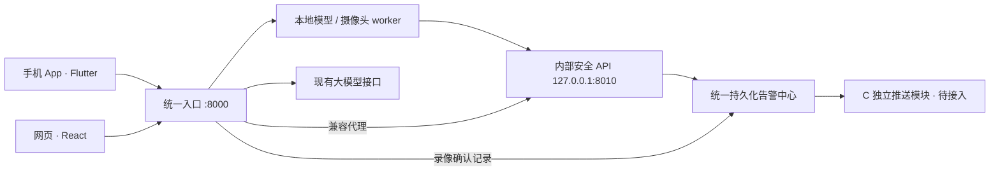

# 安居视界 App 仓库结构

采用两个客户端、一个共享服务项目。App、网站独立维护界面，共享后端承载数据、模型、任务和告警。手机只有一个 8000 根地址和访问令牌；共享服务内部保留两个进程。



```text
anju-vision-app/
├─ server/                 本次发布的 A 共享后端
│  ├─ backend/
│  ├─ safety/
│  ├─ detector/
│  ├─ models/
│  ├─ tools/ffmpeg/
│  ├─ web-dist/
│  ├─ scripts/
│  ├─ data/               私有数据，不提交
│  ├─ runtime/            私有配置、日志，不提交
│  └─ .env                大模型等私有设置，不提交
├─ docs/                   当前架构与三人分工
├─ AnjuVision-v1.2.1-*.apk  历史 APK
├─ AnjuVision-v1.2.1-source.zip  历史 App 源码包
└─ 原手册、截图与验证记录   历史交付物
```

## 操作入口

1. 日常手机和网页联调：在 `server/` 安装依赖后启动 `start-phone.bat`。
2. 电脑打开 `http://127.0.0.1:8000/`。手机填写服务端 `runtime/手机连接参数.txt` 中的一组统一配置；旧 App 的两个入口填相同地址和令牌，B 负责合为一个设置。
3. 网页源码独立维护于 [anju-vision-website](https://github.com/BBBDDxuan/anju-vision-website)，本次后端包含可运行的 `server/web-dist/`。
4. B/C 负责 App 统一业务接口、通知和新版 APK。本次发布 A 后端，不改写根目录历史 APK 或源码 ZIP。

手机开启热点、电脑连接热点可以用于联调，取决于设备间能否互访。App 填电脑在热点中的 IP。换网络后需重新启动并更新地址。手机只访问 8000；内部安全令牌由代理保留在电脑。实时摄像头控制仍保留原本的本机访问限制。

统一告警接入两种已经视觉复核确认的来源，提供稳定 ID、来源、证据、处理状态和增量同步，保存在 `server/data/alert-center/`。新启动器关闭旧安全 worker，由统一 outbox 对接 C 的推送模块；未接入时不发送推送。B/C 的接口契约见 [PHONE_API_CONTRACT.md](../server/docs/PHONE_API_CONTRACT.md)。真实摄像头、真实录像、两部手机与后台通知仍须按 [A 交接说明](../server/docs/ROLE_A_HANDOFF_20261104.md) 联调验收。

## 运行与部署

现阶段无需购买服务器，电脑充当服务端；关机后远程分析和 API 无法使用。长期运行可将共享服务部署到常开服务器，并配置 HTTPS、认证和数据备份；GPU 检测是否部署到服务器需按算力和摄像头网络决定。此迁移只整理本地结构，没有执行云部署。

模型提供商与原接口沿用。密钥在服务端本机填写，不放进手机包或网页代码。根目录旧文档和交付日志保留作历史证据，涉及当前统一接口时以本次契约为准。
